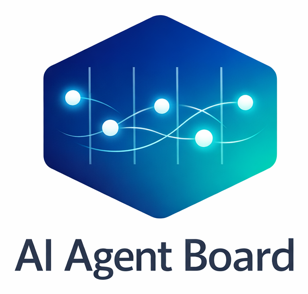
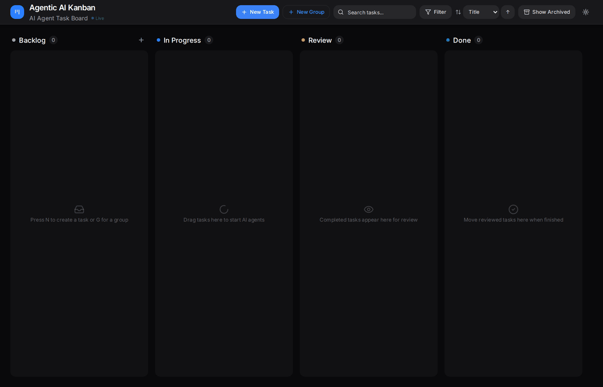

<p align="center">
  
</p>

# AI Router Board

[English](#english) | [فارسی](#فارسی) · [صفحهٔ کامل فارسی](README.fa.md)

[](https://github.com/66Hamidreza/ai-router-board/actions/workflows/ci.yml)
[](LICENSE)
[](package.json)
[](https://github.com/66Hamidreza/ai-router-board/releases)

## English

A local Kanban board for AI-assisted work: route public text tasks to a free-provider pool, send coding tasks to agents, and review progress, results, and recorded usage in one place. Explicit sensitivity checks keep confidential tasks out of the free pool.

Based on [DanWahlin/ai-agent-board](https://github.com/DanWahlin/ai-agent-board), licensed under [MIT](LICENSE).



### Features

- Backlog → In Progress → Review → Done, with task templates, search, and task groups with configurable parallelism.
- Live agent events and terminal output over WebSocket; optional Git worktrees, local merge, and pull requests.
- SQLite by default; optional PostgreSQL.
- Routing reasons, deterministic free-answer checks, one bounded escalation, and per-attempt usage in **Routing & usage**. Unknown usage is distinct from zero; coding-agent cost coverage is incomplete.
- Clean registered Board worktrees can be removed automatically; dirty, active, or mismatched paths are retained. Branches are preserved.

### Routing and confidentiality

| Tier | Target | Policy / current behavior |
|---|---|---|
| 0 | Script | Reserved; requests are rejected |
| 1 | Groq → Gemini → OpenRouter | Explicitly `public`, text only, no `repoPath` |
| 2 | Codex | Mechanical changes and frontend keywords |
| 3 | Claude | Backend, security, architecture, debugging, and default |
| Gate | Sensitivity + confidential roots | Missing sensitivity becomes `confidential`; `CONFIDENTIAL_REPO_ROOTS` blocks free dispatch regardless of a public label |

An explicit agent wins over a requested tier, then keyword routing applies. A project's configured default agent can take precedence at task creation. With no available free provider, creation/update routes can choose Claude and record the reason. The table describes the current code; team review and delegation policy still applies.

The free pool reads protected external key files and rechecks policy before dispatch. Quota/5xx responses return a retry time (numeric `Retry-After`, otherwise 60 seconds); hard failures cool down a provider for ten minutes. Waiting cards require a manual restart after that time. Network/quota errors do not trigger paid escalation.

Empty, refusal, echo, selected length-limit, and Persian-translation checks can reject a free answer and escalate once to Codex. Coding-agent output has no automatic acceptance/escalation loop. These checks do not establish correctness or guarantee provider billing. See the [router reference](docs/ROUTING.md).

### Quick start

Use Node.js 22+, npm 10+, and Git. Install and authenticate any coding CLI separately, or configure a free provider for public text tasks.

```bash
git clone https://github.com/66Hamidreza/ai-router-board.git
cd ai-router-board
npm ci
cp packages/server/.env.example packages/server/.env
cp packages/client/.env.example packages/client/.env
npm run dev
```

Open [localhost:8081](http://localhost:8081). The API listens on loopback port 8080. Create a project and a card, set sensitivity and any repository/agent options, move it to In Progress, then start the agent. Review the output, changes, and tests before merging.

### Docker

```bash
docker compose --profile app up --build -d app
```

Open [localhost:8080](http://localhost:8080) for the built UI and API. The optional app profile uses persistent SQLite; plain Compose starts only PostgreSQL. Coding CLIs and credentials are configured separately inside the container. Image pull, key mounts, PostgreSQL, and authentication details: [Docker installation](docs/DOCKER.md) · [نصب فارسی](docs/fa/install.md).

### Agents and integrations

Registered coding providers are GitHub Copilot, Claude Code, OpenAI Codex, OpenCode, Hermes, OpenClaw, and Grok. Availability depends on the CLI, account, and server environment. The shared SDK normalizes session events; the server manages timeouts and cleanup. See [agent setup](docs/fa/agents.md).

`POST /api/orchestrations` supports idempotent task creation with an `Idempotency-Key`, exact project id/name/alias, and a ready coding agent. Scoped service tokens can read projects/agents, create/read/message orchestrations, and manage task relationships; they cannot merge or administer projects. See the [Hermes integration](integrations/hermes-agent-board/README.md).

## Environment Variables


Configure the API in `packages/server/.env` and Vite in `packages/client/.env`, or export variables into the launching process. Root `.env` is an example template, not a shared configuration loader for both workspaces.

| Variable | Default | Purpose |
|----------|---------|---------|
| `HOST`, `PORT` | `127.0.0.1`, `8080` | Server bind; Vite also reads `HOST` and uses port 8081 |
| `API_URL` | `http://localhost:8080` | Vite API/WebSocket proxy target |
| `API_KEY`, `VITE_API_KEY` | unset | Full-access API token; client value must match and is exposed to browser code |
| `SERVICE_TOKENS` | unset | Scoped integration credentials; prefer SHA-256 digests |
| `DATABASE_URL` | unset | PostgreSQL URL; otherwise SQLite |
| `DB_PATH` | `./data/agentboard.db` | SQLite path, relative to server working directory |
| `AGENTBOARD_HOME` | `~/agentboard` | Configuration home; default clone root is its `projects` subdirectory |
| `ALLOWED_REPO_ROOTS` | home, temporary directory, workspace | Comma-separated allowed paths; configured clone root is also included |
| `PROJECTS_DIR` | unset | Additional default allowed repository root |
| `CONFIDENTIAL_REPO_ROOTS` | empty | Comma-separated confidential roots; accepts `~` |
| `LLM_KEY_DIR` | `~/.config/llm` | Key directory containing `groq.key`, `gemini.key`, `openrouter.key` |
| `FREE_GROQ_MODEL` | `llama-3.3-70b-versatile` | Groq model |
| `FREE_GEMINI_MODEL` | `gemini-flash-latest` | Gemini model |
| `FREE_OPENROUTER_MODEL` | `google/gemini-3.5-flash-lite` | OpenRouter model; free route or Google BYOK restriction applies |
| `AGENT_TIMEOUT_MS` | `3600000` | Run timeout; per-task override is 1–240 minutes |
| `AGENTBOARD_DISABLE_AGENT_STARTUP` | unset | `1` or `true` disables coding-provider startup for tests |
| `ALLOWED_ORIGINS` | `http://localhost:8081,http://localhost:4175,http://localhost:4176` | CORS and WebSocket origin allowlist |
| `ALLOWED_HOSTS`, `VITE_ALLOWED_HOSTS` | `localhost,127.0.0.1` | Server WebSocket and Vite host allowlists |
| `AGENT_BOARD_PUBLIC_URL` | request origin | Base URL for orchestration task links |
| `HERMES_COMMAND` | `hermes` | Hermes executable used for detection and startup |

`COPILOT_MODEL`, `CLAUDE_MODEL`, and `CODEX_MODEL` are read by the installed agent SDK; when unset, each uses its configured agent default. The model IDs in the environment templates are examples. The SDK also reads `OPENCODE_MODEL`, `GROK_COMMAND`/`GROK_BIN`, `GROK_MODEL`, `HERMES_MODEL`/`HERMES_INFERENCE_MODEL`, `HERMES_ACCEPT_HOOKS`, `OPENCLAW_COMMAND`, `OPENCLAW_MODEL`, and `COPILOT_DENIED_TOOLS`. OpenClaw credentials and CLI environment settings are forwarded to its ACP process. See the [configuration guide](docs/fa/configuration.md) for examples and integration/test variables.

### Tests

```bash
npm run build:shared
npm test -w @ai-agent-board/server
# Install browser dependencies once before the full gate:
npx playwright install --with-deps chromium
npm run gate:required
```

The required gate runs server contracts, Hermes integration checks, builds, and isolated Playwright tests. It fails if required E2E cannot run. `npm run test:e2e:required` runs the required browser suite alone. Live-model evaluation is separate: [evaluation guide](docs/EVAL.md).

### Development

```bash
npm run dev              # shared build + API + Vite
npm run dev:server       # API only, after build:shared
npm run dev:client       # Vite only
npm run build:shared
npm run build:server
npm run build:client
```

Source: `packages/client` (React/Vite/Tailwind), `packages/server` (Express/SDKs/SQLite/PostgreSQL), `packages/e2e` (Playwright), and `shared` (TypeScript contracts). Workspace names remain `@ai-agent-board/*`. The server does not serve static assets directly; the Docker image supplies nginx.

Runs default to 60 minutes, with task overrides of 1–240 minutes. Raw events persist in the database until rerun/deletion; apply an appropriate retention policy. See [contribution instructions](CONTRIBUTING.md) for checks and commit style.

### Documentation

| Topic | Guide |
|---|---|
| Container installation | [Docker](docs/DOCKER.md) · [فارسی](docs/fa/install.md) |
| Router architecture and providers | [English](docs/ROUTING.md) · [فارسی](docs/fa/routing.md) |
| Evaluation | [English](docs/EVAL.md) |
| Configuration and agents | [Configuration](docs/fa/configuration.md) · [Agents](docs/fa/agents.md) |
| Troubleshooting | [FAQ](docs/fa/faq.md) |
| Contributing | [English](CONTRIBUTING.md) · [فارسی](docs/fa/contributing.md) |
| Security | [English](SECURITY.md) · [فارسی](docs/fa/security.md) |
| Release history | [Changelog](CHANGELOG.md) |

### Security

Keep the board on loopback. Agents can execute commands and modify repositories. Confidential sensitivity blocks free routing; coding agents may still send data to their own services. Store keys outside the repository, limit mounts, and review outputs. Network access needs TLS and an authenticated outer boundary. `VITE_API_KEY` is visible in browser assets; service tokens alone do not secure all browser routes. Report vulnerabilities through [private advisories](https://github.com/66Hamidreza/ai-router-board/security/advisories/new).

### Credits and contributors

Built with OpenAI Codex and Claude (Anthropic) as AI coding collaborators, on top of DanWahlin/ai-agent-board (MIT).

| Contributor | Role |
|---|---|
| [@66Hamidreza](https://github.com/66Hamidreza) | Maintainer |
| OpenAI Codex | AI coding collaborator |
| Claude (Anthropic) | AI coding collaborator |
| [Dan Wahlin](https://github.com/DanWahlin) | Upstream author |

[MIT license](LICENSE). Preserve upstream attribution when redistributing.

<div dir="rtl">

## فارسی

این پروژه یک تابلوی کانبان محلی برای مدیریت کار با کمک هوش مصنوعی است. متن عمومی به مجموعهٔ ارائه‌دهندگان رایگان و کار برنامه‌نویسی به عامل مناسب سپرده می‌شود. روند اجرا، نتیجه و مصرف ثبت‌شده در همان کارت دیده می‌شود. بررسی حساسیت، کارهای محرمانه را از مسیر رایگان دور نگه می‌دارد.

بر پایهٔ [DanWahlin/ai-agent-board](https://github.com/DanWahlin/ai-agent-board) با مجوز [MIT](LICENSE).

### امکانات

- ستون‌های کارهای آینده، در حال اجرا، بازبینی و پایان‌یافته؛ الگوهای کار، جست‌وجو و گروه‌های کاری با هم‌زمانی قابل تنظیم.
- نمایش زندهٔ رویدادها و ترمینال با WebSocket، جداسازی اختیاری با Git worktree، ادغام محلی و ساخت درخواست تغییر.
- SQLite بدون تنظیم اولیه و PostgreSQL به‌صورت اختیاری.
- نمایش دلیل مسیریابی، کنترل پاسخ رایگان، یک بار ارتقا و ثبت مصرف هر تلاش در بخش «Routing & usage». مصرف نامعلوم با صفر فرق دارد؛ ثبت هزینهٔ عامل‌های برنامه‌نویسی کامل نیست.
- پاک‌سازی خودکار worktreeهای ثبت‌شده و بدون تغییر؛ مسیرهای دارای تغییر، فعال یا نامنطبق و همچنین شاخه‌ها حفظ می‌شوند.

### سطح‌ها و دروازهٔ محرمانگی

| سطح | مقصد | رفتار فعلی و محدودیت |
|---|---|---|
| 0 | اسکریپت | رزرو شده؛ درخواست رد می‌شود |
| 1 | Groq، سپس Gemini و OpenRouter | فقط متن با حساسیت صریح `public` و بدون `repoPath` |
| 2 | Codex | کار مکانیکی و واژه‌های مربوط به رابط کاربری |
| 3 | Claude | بک‌اند، امنیت، معماری، اشکال‌زدایی و حالت پیش‌فرض |
| دروازه | حساسیت و ریشهٔ محرمانه | حساسیت نامشخص، `confidential` است؛ `CONFIDENTIAL_REPO_ROOTS` با برچسب عمومی دور زده نمی‌شود |

عامل صریح بر سطح درخواستی مقدم است و سپس قواعد واژه‌ای اعمال می‌شوند. عامل پیش‌فرض پروژه ممکن است هنگام ساخت کارت پیش از مسیریابی خودکار انتخاب شود. اگر ارائه‌دهندهٔ رایگان آماده نباشد، مسیر ساخت یا ویرایش کارت می‌تواند Claude را همراه دلیل انتخاب کند. جدول، رفتار کد فعلی را شرح می‌دهد؛ سیاست بازبینی و تقسیم کار تیم همچنان برقرار است.

مجموعهٔ رایگان کلیدها را از فایل‌های امن بیرون مخزن می‌خواند و پیش از ارسال، سیاست را دوباره بررسی می‌کند. خطای سهمیه یا 5xx زمان تلاش بعدی می‌دهد؛ از `Retry-After` عددی یا مقدار پیش‌فرض 60 ثانیه استفاده می‌شود. خطای قطعی، ارائه‌دهنده را ده دقیقه کنار می‌گذارد. کارت منتظر را پس از زمان اعلام‌شده دستی اجرا کنید؛ زمان‌بندی خودکار وجود ندارد. خطای شبکه یا سهمیه باعث ارتقای پولی نمی‌شود.

پاسخ خالی، امتناع، تکرار درخواست، بعضی محدودیت‌های طول و ترجمهٔ فارسی کنترل می‌شوند. رد پاسخ رایگان می‌تواند یک بار کار را به Codex ارتقا دهد. پاسخ عامل برنامه‌نویسی حلقهٔ کنترل و ارتقای خودکار ندارد. این بررسی‌ها تضمین درستی پاسخ یا صورتحساب صفر نیستند. [راهنمای مسیریابی](docs/fa/routing.md) جزئیات را توضیح می‌دهد.

### شروع سریع

Node.js نسخهٔ 22 یا بالاتر، npm نسخهٔ 10 یا بالاتر و Git لازم است. ابزار عامل را جدا نصب و احراز هویت کنید؛ برای متن عمومی، تنظیم کلید یک ارائه‌دهندهٔ رایگان کافی است.

</div>

```bash
git clone https://github.com/66Hamidreza/ai-router-board.git
cd ai-router-board
npm ci
cp packages/server/.env.example packages/server/.env
cp packages/client/.env.example packages/client/.env
npm run dev
```

<div dir="rtl">

تابلو در [localhost:8081](http://localhost:8081) و API روی درگاه محلی 8080 در دسترس است. پروژه و کارت بسازید، حساسیت و تنظیم مخزن و عامل را بررسی کنید، کارت را به حالت اجرا ببرید و عامل را شروع کنید. پیش از ادغام، خروجی، تغییر فایل‌ها و آزمون‌ها را بازبینی کنید.

### نصب با Docker

</div>

```bash
docker compose --profile app up --build -d app
```

<div dir="rtl">

رابط ساخته‌شده و API در [localhost:8080](http://localhost:8080) در دسترس‌اند. پروفایل اختیاری برنامه از SQLite با حجم ماندگار استفاده می‌کند؛ اجرای سادهٔ Compose فقط PostgreSQL را بالا می‌آورد. ابزارها و اعتبارنامه‌های عامل را جدا در کانتینر آماده کنید. دریافت تصویر GHCR و تنظیم کلید و پایگاه داده: [نصب فارسی](docs/fa/install.md) · [راهنمای Docker](docs/DOCKER.md).

### عامل‌ها و یکپارچه‌سازی

عامل‌های ثبت‌شده شامل GitHub Copilot، Claude Code، OpenAI Codex، OpenCode، Hermes، OpenClaw و Grok هستند. آماده بودن به CLI، حساب و محیط سرور وابسته است. SDK مشترک رویدادها را یکسان می‌کند و سرور زمان اجرا و پاک‌سازی را مدیریت می‌کند. [آماده‌سازی عامل‌ها](docs/fa/agents.md) را بخوانید.

مسیر `POST /api/orchestrations` با سرآیند `Idempotency-Key`، شناسه یا نام یا نام مستعار دقیق پروژه و عامل آماده، کارت را بدون ساخت تکراری ایجاد می‌کند. توکن محدود برای خواندن پروژه و عامل، ساخت و خواندن و پیام کار هماهنگ‌شده و روابط کارت کاربرد دارد؛ اجازهٔ ادغام یا مدیریت پروژه نمی‌دهد. جزئیات در [افزونهٔ Hermes](integrations/hermes-agent-board/README.md) آمده است.

### متغیرهای محیطی

سرور تنظیم را از `packages/server/.env` و رابط از `packages/client/.env` می‌خواند؛ متغیرهای صادرشده در محیط فرایند هم قابل استفاده‌اند. فایل نمونهٔ ریشه بارگذار مشترک نیست.

| تنظیم | متغیرهای اصلی |
|---|---|
| شبکه و احراز هویت | `HOST`، `PORT`، `API_URL`، `API_KEY`، `VITE_API_KEY`، `SERVICE_TOKENS` |
| داده و مخزن | `DATABASE_URL`، `DB_PATH`، `AGENTBOARD_HOME`، `ALLOWED_REPO_ROOTS`، `PROJECTS_DIR` |
| سیاست و مدل رایگان | `CONFIDENTIAL_REPO_ROOTS`، `LLM_KEY_DIR`، `FREE_GROQ_MODEL`، `FREE_GEMINI_MODEL`، `FREE_OPENROUTER_MODEL` |
| دسترسی و زمان اجرا | `ALLOWED_ORIGINS`، `ALLOWED_HOSTS`، `VITE_ALLOWED_HOSTS`، `AGENT_TIMEOUT_MS`، `AGENT_BOARD_PUBLIC_URL` |

پیش‌فرض‌ها و نمونهٔ تنظیم عامل‌ها و آزمون در [راهنمای پیکربندی](docs/fa/configuration.md) و جدول انگلیسی همین صفحه آمده‌اند. کلیدهای رایگان در فایل‌های `groq.key`، `gemini.key` و `openrouter.key` با دسترسی 0600 بیرون مخزن نگهداری می‌شوند. پس از تغییر کلید سرور را بازراه‌اندازی کنید. برای اجرای واقعی عامل، `AGENTBOARD_DISABLE_AGENT_STARTUP` را فعال نکنید.

### آزمون و توسعه

</div>

```bash
npm run build:shared
npm test -w @ai-agent-board/server
npx playwright install --with-deps chromium
npm run gate:required
```

<div dir="rtl">

دروازهٔ الزامی، کنترل قرارداد سرور، آزمون یکپارچه‌سازی Hermes، ساخت و آزمون مرورگر را اجرا می‌کند؛ اگر آزمون لازم قابل اجرا نباشد شکست می‌خورد. فقط آزمون مرورگر با `npm run test:e2e:required` اجرا می‌شود. [ارزیابی مدل](docs/EVAL.md) جداگانه و نیازمند دسترسی ارائه‌دهنده است.

برای توسعه از `npm run dev` یا دو دستور `npm run dev:server` و `npm run dev:client` استفاده کنید. خروجی نهایی به‌ترتیب با `npm run build:shared`، `npm run build:server` و `npm run build:client` ساخته می‌شود. کد رابط در `packages/client`، سرور در `packages/server`، آزمون مرورگر در `packages/e2e` و قراردادها در `shared` هستند. نام workspaceها همچنان `@ai-agent-board/*` است. سرور فایل ایستا ارائه نمی‌کند؛ تصویر Docker برای این کار nginx دارد.

مهلت پیش‌فرض اجرا یک ساعت و بازهٔ قابل تنظیم هر کارت 1 تا 240 دقیقه است. رویدادهای خام تا اجرای دوباره یا حذف در پایگاه داده می‌مانند؛ سیاست نگهداری مناسب تعیین کنید.

### راهنماها و امنیت

[نصب](docs/fa/install.md) · [پیکربندی](docs/fa/configuration.md) · [مسیریابی](docs/fa/routing.md) · [عامل‌ها](docs/fa/agents.md) · [پرسش‌های رایج](docs/fa/faq.md) · [مشارکت](docs/fa/contributing.md) · [امنیت](docs/fa/security.md) · [تاریخچهٔ انتشار](CHANGELOG.md)

تابلو را روی اتصال محلی نگه دارید. عامل‌ها می‌توانند فرمان اجرا و مخزن را تغییر دهند. برچسب محرمانه مسیر رایگان را می‌بندد؛ عامل برنامه‌نویسی ممکن است داده را به سرویس خود بفرستد. کلید را بیرون مخزن نگه دارید، حجم‌های متصل را محدود و نتیجه را بازبینی کنید. دسترسی شبکه به TLS و احراز هویت بیرونی نیاز دارد. `VITE_API_KEY` در مرورگر دیده می‌شود و توکن سرویس به‌تنهایی همهٔ مسیرهای رابط را محافظت نمی‌کند. آسیب‌پذیری را از [گزارش خصوصی GitHub](https://github.com/66Hamidreza/ai-router-board/security/advisories/new) بفرستید.

### سپاس و مشارکت‌کنندگان

با همکاری OpenAI Codex و Claude (Anthropic) به‌عنوان همکاران هوش مصنوعی در برنامه‌نویسی، بر پایهٔ DanWahlin/ai-agent-board با مجوز MIT ساخته شده است.

| مشارکت‌کننده | نقش |
|---|---|
| [@66Hamidreza](https://github.com/66Hamidreza) | نگه‌دارنده |
| OpenAI Codex | همکار هوش مصنوعی در برنامه‌نویسی |
| Claude (Anthropic) | همکار هوش مصنوعی در برنامه‌نویسی |
| [Dan Wahlin](https://github.com/DanWahlin) | نویسندهٔ پروژهٔ بالادستی |

مجوز [MIT](LICENSE) است؛ هنگام بازنشر، انتساب بالادستی را حفظ کنید.

</div>
