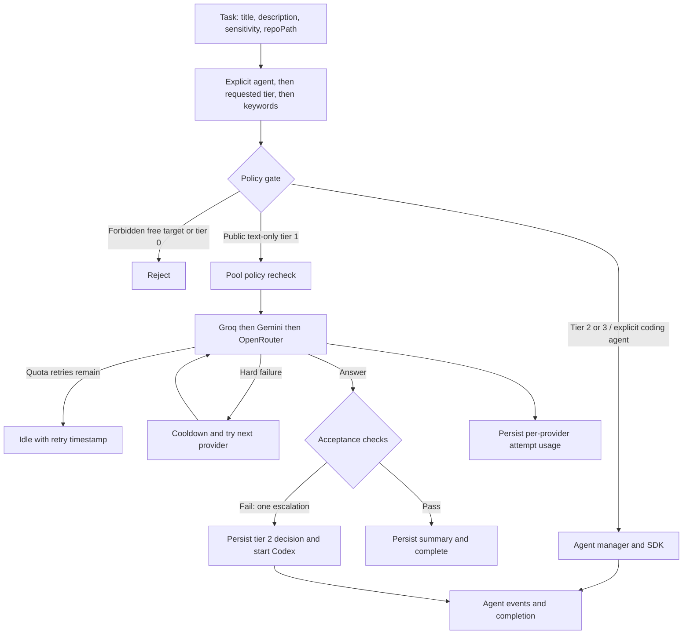

# Router developer reference

The board separates deterministic routing (`router.ts`), free HTTP dispatch and pool state (`free-provider.ts`), output acceptance (`acceptance.ts`), and lifecycle orchestration (`agent-manager.ts`), all under `packages/server/src/services/`. There are no separate pool/usage service files: pool logic lives in `free-provider.ts`; SQLite/PostgreSQL repositories persist usage. Shared task/usage contracts are in `shared/types.ts`. `TaskRoutingUsage.tsx` displays the decision and per-attempt records, refreshes on events/reconnect, and polls active tasks every five seconds.

## Routing and policy

Tier 0 means a future script tier; `routeTask` rejects it. Tier 1 is a free text-only target. Tier 2 selects Codex; tier 3 selects Claude. Explicit `agentType` wins over `requestedTier`; explicit non-Codex agents receive tier 3 metadata regardless of provider identity.

At task creation, `applyProjectDefaults` in `routes/tasks.ts` uses a configured project default agent before automatic routing. When creation or sensitivity/tier edits choose a free target but no free provider is available, those routes persist a tier-3 Claude fallback and its reason. This differs from runtime quota or transport failures, which do not escalate.

Without overrides, keyword priority is: backend/security/auth/schema/RLS/architecture/debug → tier 3; UI/frontend/CSS/component/layout/RTL/design → tier 2; rename/refactor/boilerplate/migrate/add tests → tier 2; summarize/translate/classify/draft → tier 1 only for `public` without `repoPath`; everything else → tier 3. Selected Persian keywords are also recognized; read `routeTask` before changing matching rules. These are heuristics, not semantic task analysis.

Missing sensitivity defaults to `confidential` in persistence. `checkPolicy` rejects any free target unless sensitivity is exactly `public`, and rejects repository paths beneath `CONFIDENTIAL_REPO_ROOTS`, even with a public label. Requested tier 1 rejects any `repoPath`; automatic tier 1 requires no path. Pool entry and each provider attempt repeat the sensitivity check. Preserve validation at all entry points: the pool's text-only task type does not itself validate a repository path.

`CONFIDENTIAL_REPO_ROOTS` accepts comma-separated roots and expands `~`; path checks use resolved lexical paths. This is not an OS sandbox or a promise that paid agents keep data local. `ALLOWED_REPO_ROOTS` controls board repository access separately, and always includes the configured clone root.

## Free pool behavior

Credentials are read from `groq.key`, `gemini.key`, and `openrouter.key` in `LLM_KEY_DIR` (default `~/.config/llm`). Files must be regular files without any group/other permission bits; use mode 0600. Credential results, including missing/invalid files, are cached per filename for the process lifetime. Restart after key changes. There is no direct free-provider API-key environment fallback.

Endpoints are fixed HTTPS allowlisted hosts; redirects are rejected, response size is capped at 1 MiB, and known keys are redacted from returned text/errors. OpenRouter uses at most 4096 output tokens. Non-Google routes must end in `:free` or equal `openrouter/free`; `google/` routes select only `google-ai-studio` with fallback disabled and require appropriate BYOK configuration at the provider. A free label is not a billing guarantee.

HTTP 429/5xx sets an in-memory retry time from numeric `Retry-After` seconds, or 60 seconds by default. Other failures set a 10-minute in-memory cooldown and allow the next provider. If retries remain after the pool is exhausted, return `waiting` with the earliest timestamp; the manager returns the card to idle and clears the run request. There is no automatic wakeup scheduler. Missing keys or only hard failures fail the run. State resets with the process/pool.

## Acceptance, escalation, and accounting

`checkFreeResult` rejects empty/refusal/echo output, selected explicit word/sentence limits, and missing Persian text for Persian translation requests. Approximate word counts allow ±30% for requests of at least five words. This is a deterministic heuristic, not a correctness judge.

`MAX_ESCALATIONS = 1`. The manager handles a rejected free answer by persisting the reason/effective tier, preserving the card lifecycle, and starting Codex. The helper also defines tier 2 → Claude, but coding-agent outputs do not currently run this acceptance/escalation loop. Quota/transport errors do not trigger paid escalation.

Free attempts record provider, model, times, outcome, token counts, and `costUsd: 0`; unknown tokens stay `null`. A transport-complete attempt can later fail acceptance. Zero recorded cost does not establish actual provider billing; coding-agent usage is not fully accounted for by this path.

## Environment

| Variable | Default | Meaning |
|---|---|---|
| `CONFIDENTIAL_REPO_ROOTS` | empty | Confidential repository roots |
| `LLM_KEY_DIR` | `~/.config/llm` | External credential directory; use an expanded absolute path when overriding |
| `FREE_GROQ_MODEL` | `llama-3.3-70b-versatile` | Groq model |
| `FREE_GEMINI_MODEL` | `gemini-flash-latest` | Gemini model |
| `FREE_OPENROUTER_MODEL` | `google/gemini-3.5-flash-lite` | OpenRouter model |
| `AGENT_TIMEOUT_MS` | `3600000` | Manager run timeout; task override 1–240 minutes |
| `AGENTBOARD_DISABLE_AGENT_STARTUP` | unset | `1` or `true` disables coding-agent startup for CI |

See [README](../README.md#environment-variables) for auth, database, network and SDK settings, and [Docker installation](DOCKER.md) for container paths and proxy configuration. The standalone pool defaults to a 60-second abort signal; the manager supplies its own run signal.

## Adding a free provider

1. Extend the `FreeProvider` union, ordered provider list, endpoint/host allowlists, display label, and model selector in `free-provider.ts`. Preserve fixed HTTPS endpoints, redirect rejection, redaction and abort handling.
2. Keep external credential loading, permission checks and model restrictions. Adapt the request/response parser if the API is not OpenAI-compatible; return nullable token counts.
3. Preserve repeated policy checks, quota handling, hard-failure cooldown and `onAttempt` accounting. Never add a confidential fallback into the free pool.
4. Add meaningful provider/pool tests in `packages/server/tests`, including unsafe credentials, quota, abort, failover and policy denial. Update docs and configuration examples.
5. Run `npm run build:shared`, `npm test -w @ai-agent-board/server`, server/client builds, and the required gate when available. Coding-agent providers instead belong in the SDK integration, registration and detection path.

## Next steps

Run the [evaluation guide](EVAL.md) for synthetic live-provider checks, or follow [contributing](../CONTRIBUTING.md) for deterministic regressions. This router builds on DanWahlin/ai-agent-board (MIT).
